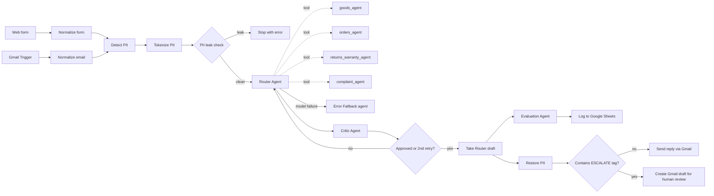

# AI Customer Support for an Online Store (n8n)

**Router + Workers + Critic + Human-in-the-Loop + Evaluation**

An [n8n](https://n8n.io) workflow that answers customer support messages for an online store using a team of AI agents. Messages arrive from a website form or by email. The workflow strips out personal data, sends each message to the right specialist agent, has a second agent review the answer, and then either replies automatically or leaves a draft for a human to approve. Every final answer is also scored for quality and logged to Google Sheets.

> Node names and prompts in the workflow are in Russian. This README gives English translations in brackets.

📖 **Full case study:** [Notion portfolio](https://ilona-bila-portfolio.notion.site/3e09e4dcbceb813d944edcb367c16f50) · Workflow file: `workflow.json`

**Key design decision: route by risk, not by convenience.** Only product, order and returns answers may be sent automatically, and only when no money is involved. Any refund or complaint always goes to a human, following an explicit "higher error cost → lower autonomy" rule. In testing, the Evaluation Agent caught a hallucinated order date (correctness 2/5) before it could reach a customer.

---

## How it works (overview)

1. **Intake.** A message arrives from the web form or Gmail and is converted to one common format.
2. **Privacy (PII pipeline).** Emails, phone numbers, and the customer's name/email are replaced with placeholders such as `{EMAIL_1}` and `{CUSTOMER_NAME}`. If anything slips through, the workflow stops, so no personal data reaches an AI model.
3. **Routing.** The Router Agent classifies the message and calls one of four worker agents as a tool.
4. **Review.** The Critic Agent checks whether the right worker was chosen and whether the draft is good enough. If not, the Router tries again, up to 2 retries.
5. **Human-in-the-loop.** Placeholders are swapped back for the real data. Answers with no escalation tag are emailed to the customer automatically. Everything else becomes a Gmail draft for a person to check.
6. **Evaluation.** In parallel, an Evaluation Agent scores the final answer and logs the result to Google Sheets. It does not block sending.

---

## Inputs

| Trigger | Node | What it receives |
|---|---|---|
| Website form | `Форма на сайте` (Form Trigger) | Required fields: `Имя` (name), `Email`, `Сообщение` (message) |
| Email | `Gmail Trigger` | Polls the connected Gmail inbox **every minute** for new messages |

Both are converted to the same internal fields:

| Field | Meaning |
|---|---|
| `customer_name` | Customer's name |
| `customer_email` | Customer's email address |
| `customer_message` | Text of the request |
| `channel` | `form` or `email` |

### Data sources (Google Sheets)

All tools read from and write to one spreadsheet, *"Кейс 1 — Интернет-магазин — база данных"*:

| Sheet | Used by | Access | Key columns |
|---|---|---|---|
| `Товары_Остатки` (products & stock) | `search_product` | read | Артикул (SKU), Название, Размер, Цвет, Цена_EUR, Остаток_шт |
| `Заказы_CRM_view` (orders) | `check_order`, `check_order1`, `check_order2` | read | Номер_заказа (order no.), Артикул, Товар, Дата_заказа, Статус_заказа, Статус_доставки |
| `Гарантийные_обращения` (warranty cases) | `check_and_log_warranty` | append or update (matched on order number) | ID_обращения, Номер_заказа, Тип_проблемы, Статус, … |
| `Evaluation_Results` | `Log Evaluation` | append | timestamp, agent_used, scores, justification |

The orders sheet is a *view* without customer name/email columns, so personal data never reaches the AI provider.

---

## Outputs

| Output | Node | When |
|---|---|---|
| Email reply to the customer | `Отправить ответ (авто)` (send reply, auto) | The answer contains no `[ESCALATE:…]` tag |
| Gmail **draft** for a human to review and send | `Создать черновик (на проверку)` (create draft for review) | The answer contains an `[ESCALATE:…]` tag |
| A row in `Evaluation_Results` | `Log Evaluation` | Every answer that passes the Critic |
| A new or updated warranty case row | `check_and_log_warranty` | Warranty/defect requests with a valid order |

Internal tags such as `[AGENT:…]` and `[ESCALATE:…]` are removed before any text reaches a customer or a draft.

---

## Nodes

### 1. Intake and normalization

| Node | Type | Purpose |
|---|---|---|
| `Форма на сайте` | Form Trigger | Website support form |
| `Gmail Trigger` | Gmail Trigger | Picks up new emails |
| `Нормализация - форма` (normalize form) | Set | Maps form fields to the common format |
| `Нормализация - email` (normalize email) | Set | Takes sender name/address and plain-text body from the email |

### 2. PII (personal data) pipeline

| Node | Type | Purpose |
|---|---|---|
| `Detect PII via Regexp` | Code | Finds emails and phone numbers in the message using regular expressions |
| `Tokenize and replace PII` | Code | Replaces them with tokens (`{EMAIL_1}`, `{PHONE_1}`) and stores a `pii_map` (token → real value), including `{CUSTOMER_NAME}` and `{CUSTOMER_EMAIL}` |
| `Проверка обезличивания` (anonymization check) | Code | Re-scans the cleaned text and **throws an error** if any email or phone is still present |

### 3. Router (supervisor)

| Node | Type | Purpose |
|---|---|---|
| `Router Agent` | AI Agent | Classifies the request and calls exactly one worker. Prefixes its answer with `[AGENT:name]`. On a retry, it reads the Critic's feedback and either re-routes or improves the answer |

Classification priority, first match wins:

1. **complaint** (unhappy, repeated contact, "talk to a manager") → `complaint_agent`
2. **order_status** (order number or "my order") → `orders_agent`
3. **product_info** (general product question) → `goods_agent`
4. **return_warranty** (return, broken, defect) → `returns_warranty_agent`

### 4. Worker agents (called by the Router as tools)

| Agent | Tool(s) | What it does | Escalates when |
|---|---|---|---|
| `goods_agent` | `search_product` | Stock, sizes, colors and price by **SKU** (e.g. `W-220`). Asks for the SKU if none is given; never guesses | SKU not found → `product_not_found` |
| `orders_agent` | `check_order2` | Order and delivery status by order number. Asks for the number if missing | Order not found → `order_not_found`; customer explicitly demands compensation → `delivery_compensation` |
| `returns_warranty_agent` | `check_order`, `check_and_log_warranty` | Checks the order, applies store rules (**14 days** for returns, **12 months** warranty), and logs warranty cases. Never approves refunds itself | Order not found → `order_not_found`; any processed case → `review_required` |
| `complaint_agent` | `check_order1` | Drafts an empathetic acknowledgement and a summary for staff. Never offers compensation | **Always** → `complaint_review` |

### 5. Quality control

| Node | Type | Purpose |
|---|---|---|
| `Critic Agent` | AI Agent | Step 1: was the right worker chosen? Step 2: scores the draft out of 5. Replies with `[DECISION:APPROVE]`, `[DECISION:REROUTE:<agent>]` or `[DECISION:REVISE_CONTENT]`. Offering compensation without escalation scores 0 |
| `Проверка Critic.` (Critic check) | IF | Continues if the Critic approved **or** this is already the 3rd pass (`$runIndex >= 2`); otherwise loops back to the Router with the Critic's feedback |
| `Взять черновик Router` (take Router draft) | Set | Takes the Router's latest answer forward |

### 6. Sending and human-in-the-loop

| Node | Type | Purpose |
|---|---|---|
| `Восстановление PII перед отправкой` (restore PII) | Code | Puts the real data back in place of the tokens, removes internal tags, and recovers the real recipient email |
| `Проверка эскалации` (escalation check) | IF | Does the answer contain `[ESCALATE:`? |
| `Отправить ответ (авто)` | Gmail | Sends the reply. Subject: "Re: Ваше обращение в поддержку" |
| `Создать черновик (на проверку)` | Gmail (draft) | Saves a draft for a human. Subject: "Ответ на ваше обращение — требуется проверка" |

### 7. Evaluation

| Node | Type | Purpose |
|---|---|---|
| `Evaluation Agent.` | AI Agent | Scores the final answer: `correctness`, `completeness` and `politeness` (1–5), plus `hallucinations` and `needs_human` (true/false), `agent_used` and a short `justification` |
| `Structured Output Parser` | Output parser | Forces the answer into a strict JSON schema (with auto-fix) |
| `Log Evaluation` | Google Sheets | Appends the scores to `Evaluation_Results` |

### 8. Language models

Every agent has a **primary** model (OpenRouter) and a **fallback** model (Groq). If the primary fails, n8n switches to the fallback automatically. The Critic and Evaluation agents use `anthropic/claude-haiku-4.5` via OpenRouter. The Evaluation fallback is `groq/compound-mini`. The other agents use n8n's default OpenRouter model.

---

## Error handling

| Mechanism | Where | Behavior |
|---|---|---|
| **PII leak guard** | `Проверка обезличивания` | Throws an error and stops the run if personal data is still in the text, so it is never sent to an LLM |
| **Retry** | `Router Agent` | Up to **5 attempts**, 3 seconds apart |
| **Fallback model** | All agents | Groq takes over if the OpenRouter model fails |
| **Error output branch** | `Router Agent` (`continueErrorOutput`) | If the Router still fails, the run goes to `Универсальный агент (Error Fallback)`, which writes a short apology saying a manager will reply |
| **Critic loop limit** | `Проверка Critic.` | At most 2 retries, so the loop can never run forever |
| **Escalation tags** | Workers → `Проверка эскалации` | Uncertain or sensitive cases (unknown order or product, compensation, refunds, warranty, all complaints) go to a human instead of the customer |
| **No guessing** | Worker prompts | Agents ask for a missing order number or SKU instead of inventing data |
| **Structured output auto-fix** | `Structured Output Parser` | Asks the model to repair invalid JSON |

### Known gaps

- The output of `Универсальный агент (Error Fallback)` is **not connected** to any send or draft node, so its apology never reaches the customer.
- No n8n **error workflow** is configured, so a failed run (for example the PII guard firing) notifies no one.
- If the Critic still rejects the answer after 2 retries, the last draft continues anyway. It is only escalated if it already carries an `[ESCALATE:…]` tag.
- The HITL sticky note mentions catching "money in the answer", but `Проверка эскалации` only checks for the `[ESCALATE:` tag.
- PII detection covers only emails and phone numbers that match the regex. Addresses, card numbers and similar data in the message text are not masked.

---

## Setup

1. In n8n, go to **Workflows → Import from file** and select the JSON file.
2. Create these credentials and attach them to the matching nodes:
   - **OpenRouter API** (all `OpenRouter Chat Model*` nodes)
   - **Groq API** (all `Groq Chat Model*` nodes)
   - **Gmail OAuth2** (Gmail Trigger and both Gmail nodes)
   - **Google Sheets OAuth2** (all Sheets nodes)
3. Replace `YOUR_GOOGLE_SHEET_ID_1` with your own spreadsheet. It needs the four sheets and columns listed under [Data sources](#data-sources-google-sheets).
4. Activate the workflow. The form URL is shown on the `Форма на сайте` node.

The JSON contains only credential *names and IDs*, never API keys or passwords. You will need your own accounts.
