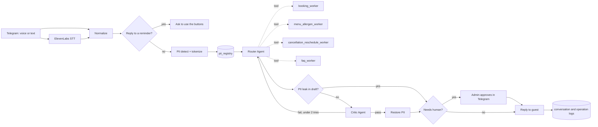

# AI Restaurant Automation: Multi-Agent Booking Assistant with RAG & GDPR Compliance

**Telegram (voice + text) · Router + 4 Workers · RAG on Qdrant · Critic loop · Human approval · Async evaluation**

A Telegram assistant for a Berlin restaurant ("Basilik") that takes bookings, answers menu and allergen questions, handles cancellations and reschedules, and answers general questions. It is built from **4 n8n workflows**: the main dialog, a booking reminder, a nightly evaluation job, and a reusable cancellation subworkflow.

📖 **Full case study:** [Notion portfolio](https://ilona-bila-portfolio.notion.site/3db9e4dcbceb81d3b13ce0547eb9304f)

---

## Problem

A single hostess was handling phone and Telegram bookings from memory:

- **3–5 hours a day** of staff time spent on repeat questions
- **30% of bookings unconfirmed**, because replies took 30–60+ minutes at peak hours
- **No-shows as high as 30%**
- Allergen questions answered from memory with no record, which is a **GDPR Art. 9** risk

**After:** replies in under a minute. Every dish-related answer is checked against a hard allergen rule before it reaches the guest. A reminder goes out automatically 2 hours before each booking. Anything involving money (deposits, refunds, prepayment) or a judgment call still goes to a human for confirmation.

---

## How it works

The other three workflows:

| Workflow | Trigger | What it does |
|---|---|---|
| **2 — Reminder-Send** | Webhook, called by `booking_worker` right after a booking is created (fire-and-forget) | Calculates "visit minus 2 hours" and waits until then. It re-checks that the booking is still active, then sends a Telegram message with **Confirm / Cancel** buttons. A "Cancel" click calls `apply_cancellation`. |
| **3 — Evaluation** | Schedule, daily at 03:00 | Reads the conversation log. An Evaluation Agent scores each final reply on 5 criteria (relevance, completeness, politeness, hallucinations, needs_human) and writes to `eval_log`. Fully asynchronous: it never blocks a reply. |
| **apply_cancellation** | Called as a subworkflow | One shared cancellation routine, used by the cancellation worker and by the reminder's "Cancel" button. It is **idempotent**: an already-cancelled booking is not cancelled twice. Timing and deposit rules lead to 4 outcomes: on time, late without deposit, late with deposit kept, or `refund_due`, which is escalated to the admin. |

---

## Key design decision

**The allergen check is a deterministic validator, not something the router decides.** Inside the Menu Worker, a mandatory `validate_allergens` tool re-checks **every** dish answer against the literal allergen payload in Qdrant before anything reaches the guest. The design doesn't trust the LLM to notice which replies "are about allergens".

**One Router can call several workers in parallel.** Real guest messages are composite ("book a table and tell me if you have gluten-free pasta"). A strict one-message-one-category model would force an artificial single classification and lose half of every mixed request.

---

## Components

### Workers (called by the Router as tools)

| Worker | Tools | Notes |
|---|---|---|
| `booking_worker` | `create_booking` (Sheets), `create_stripe_payment_link` (HTTP), `workflow 2 trigger` (HTTP) | Groups of **8+** get a Stripe deposit link (**€15/person**). Triggers the reminder workflow after a successful booking. |
| `menu_allergen_recommendation_worker` | `search_menu`, `search_policy_menu_sections`, `validate_allergens` (Qdrant) | Ingredients, allergens, nutrition, price and recommendations. Uses ReAct for ambiguous cases. |
| `cancellation_reschedule_worker` | `find_booking` (Sheets), `apply_cancellation` (subworkflow) | Finds the booking by `ref_token` and asks at most 1 clarifying question before escalating. Banquets of **15+** are always escalated. |
| `faq_worker` | `search_policy_faq` (Qdrant) | Payment, corkage, dress code, pets, hours, address and parking. No allergen validator, because the cost of an error is low. |

### Models

Every agent has a **primary** model via OpenRouter and a **fallback** model via Groq (`qwen/qwen3.6-27b`, `groq/compound`, `groq/compound-mini`). The Critic and Evaluation agents use `openai/gpt-5` as primary. Embeddings use OpenAI. The Router has per-chat memory keyed by `chat_id`.

### Data (Google Sheets, one spreadsheet)

`bookings` · `pii_registry` · `critic log` · `escalations` · `conversations_log` · `operation_log` · `eval_log`

### Knowledge base (Qdrant)

`basilik_menu` (dish cards with allergen payloads) · `basilik_policy` (policies, business lunch, kids menu, FAQ sections)

---

## Inputs and outputs

| | |
|---|---|
| **Input** | Telegram messages (text or voice) · reminder button clicks |
| **Output to guest** | Telegram text reply, or a **voice reply** (ElevenLabs TTS) if the guest sent a voice message |
| **Output to admin** | Telegram approval request (Approve / Decline) for escalated replies · `refund_due` alerts |
| **Records** | Bookings, escalations, critic log, conversation and operation logs, nightly evaluation scores |
| **Payments** | Stripe Payment Links for group deposits |

---

## Error handling and guardrails

| Mechanism | Behavior |
|---|---|
| **PII tokenization** | Name and phone are detected by regex and replaced with a `ref_token` before any LLM call. Real values are stored in `pii_registry` and restored only in the final message. |
| **PII leak check** | If the draft reply still contains personal data, it skips the Critic and goes straight to a human. |
| **Critic loop** | Checks completeness, coherence, tone and language. At most **2 attempts**, then the reply moves on. |
| **Allergen validator** | Mandatory check of every dish answer against the Qdrant payload. |
| **Human-in-the-loop** | Any `[ESCALATE:…]` tag **or** mention of money movement → admin approval in Telegram (`Send and Wait`, which resumes the same execution). |
| **Idempotent cancellation** | `apply_cancellation` checks whether the booking is already cancelled. |
| **Reminder re-check** | The reminder re-reads the booking after waiting, so a booking cancelled in the meantime gets no reminder. |
| **No automatic refunds** | Refunds are marked `refund_due` and escalated. The Stripe Refund API is deliberately **not** called from these workflows. |
| **Fallback models** | Groq takes over if OpenRouter fails, for every agent. |
| **Structured outputs** | Workers and the Router return JSON through structured output parsers. The Evaluation Agent also has an auto-fixing parser. |

### Known gaps

- **Decline is not implemented.** If the admin declines an escalated reply, nothing is sent and the guest gets no message (this is noted in the workflow itself).
- **Bookings are created without an availability check.** `check_availability` was removed from the architecture, so double-booking a slot is possible.
- No n8n error workflow is configured.

---

## Setup

1. **Import all 4 files** into n8n.
2. **Connect the subworkflows.** Copy the workflow ID of `4-apply-cancellation` and select it in the `Tool: apply_cancellation` node (workflow 1) and in the `Call 'Basilik — apply_cancellation'` node (workflow 2).
3. **Connect the reminder.** Activate workflow 2, copy its production webhook URL, and paste it into the `workflow 2 trigger` node in workflow 1. It currently points to `your-n8n-instance.example.com`.
4. **Replace placeholders:**
   - `YOUR_GOOGLE_SHEET_ID_2`: your spreadsheet with the 7 sheets listed above
   - `YOUR_TELEGRAM_CHAT_ID`: the admin's Telegram chat ID
5. **Create credentials:** Telegram, Google Sheets, OpenRouter, Groq, OpenAI (embeddings), Qdrant, ElevenLabs, Stripe.
6. **Load your menu and policies** into the Qdrant collections `basilik_menu` and `basilik_policy`.

---

## Files

| File | Workflow |
|---|---|
| `1-main-guest-dialog.json` | Main dialog: Router, workers, Critic, HITL (90 nodes incl. notes) |
| `2-reminder-send.json` | 2-hour booking reminder with Confirm / Cancel buttons |
| `3-evaluation.json` | Nightly asynchronous quality evaluation |
| `4-apply-cancellation.json` | Shared, idempotent cancellation subworkflow |

Node names and prompts are in Russian.
