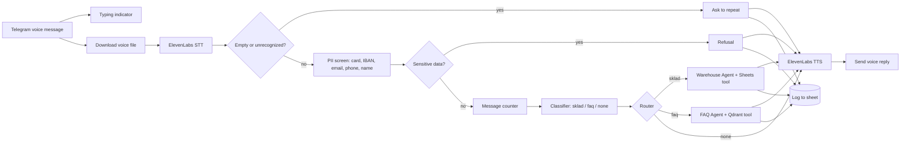

# AI Voice Assistant: Guardrail-First Multi-Agent Routing for Warehouse & Support

**Telegram voice · ElevenLabs STT/TTS · Regex PII guardrail · LLM classifier · Google Sheets + Qdrant RAG · EU AI Act Art. 50**

A Telegram voice assistant for **Nordwaren GmbH**, a German retailer of home goods, electronics and stationery. A customer sends a voice message and gets a spoken answer back. Exact stock questions go to a warehouse agent with a Google Sheets tool. Policy questions go to an FAQ agent with semantic search over a Qdrant knowledge base.

Delivered as a graded capstone project (Module 14: Multimodal AI) that had to survive a live demo.

📖 **Full case study:** [Notion portfolio](https://ilona-bila-portfolio.notion.site/3df9e4dcbceb817d90cef54c9c5962da)

---

## Problem

One assistant had to handle two very different question types, exact stock lookups and general policy/FAQ questions. It had to do this **without guessing** when data is missing, and **without leaking** sensitive customer data to the model or the log. It also had to meet the EU AI Act's mandatory **AI-disclosure requirement (Art. 50)**.

---

## How it works

---

## Key design decision

**Two structurally separate agents behind a lightweight classifier**, instead of one general agent. The Warehouse agent can only reach Google Sheets, and the FAQ agent can only reach Qdrant. Each has a narrow job and a narrow tool, so it can't answer outside its lane.

**PII is screened by regex before the text ever reaches an LLM.** It catches card numbers (with a **Luhn check**, to avoid false alarms on order numbers), IBAN, email, phone, and self-introductions ("меня зовут …"). A match means an immediate refusal with no further processing.

**AI Act disclosure fires once per chat.** Both agents share one conversation memory keyed by `chat_id`. Whichever agent answers first introduces itself as an AI, and the other one sees that in memory and doesn't repeat it.

---

## Components

| Group | Nodes |
|---|---|
| **Input** | Telegram Trigger · typing indicator · download voice file · ElevenLabs speech-to-text |
| **Guardrails** | Empty/unrecognized check · regex PII screen (`Code`) · PII routing (`IF`) · refusal text |
| **Counter** | Counts messages per chat in workflow static data and flags every 5th message (`isReminderDue`) |
| **Classifier** | AI Agent with structured output parser (`sklad` / `faq` / `none`), per-chat memory, OpenRouter primary + Groq fallback |
| **Warehouse agent** | AI Agent + Google Sheets tool (read-only stock list: SKU, name, category, stock, price). Asks clarifying questions in a fixed slot order. Retry on fail. |
| **FAQ agent** | AI Agent + Qdrant vector store tool (OpenAI embeddings) over the FAQ: delivery, payment, pickup, returns. Groq primary + OpenRouter fallback. |
| **Output** | ElevenLabs text-to-speech · Telegram send audio · log to "Черновик" sheet (runs in parallel, never blocks the reply) |

---

## Inputs and outputs

| | |
|---|---|
| **Input** | Telegram **voice** messages |
| **Output** | Spoken reply (ElevenLabs TTS) sent back to the same chat |
| **Records** | One row per interaction in Google Sheets: chat, user, category, question, answer |

---

## Error handling and guardrails

| Mechanism | Behavior |
|---|---|
| **Empty speech check** | Unrecognized or empty audio → "please repeat" instead of a guess |
| **PII refusal** | Card (Luhn-checked), IBAN, email, phone or self-introduction → refusal before any LLM call |
| **Prompt-injection wrapper** | The classifier receives the customer text inside a `<client_message>` wrapper |
| **"Not found" honesty** | Agents are instructed to say when data is missing, never to invent stock or policy |
| **Fallback models** | Every agent has a second model from another provider (OpenRouter ↔ Groq) |
| **Retry** | The Warehouse agent retries on failure |
| **Non-blocking log** | The log node continues on error, so a Sheets failure never stops the voice reply |

### Known gaps

- **Voice only.** Text messages are not handled, because the trigger goes straight to "download voice file".
- The "not found" rule lives in the agents' prompts. An earlier version enforced it with an IF-gate on a structured `found` / `hasBasis` field, but this v3 sends agent answers directly to TTS.
- No n8n error workflow is configured.

---

## Setup

1. Import `workflow.json` into n8n.
2. Replace `YOUR_GOOGLE_SHEET_ID_3` with your spreadsheet (a stock sheet and a log sheet).
3. Create credentials: Telegram, Google Sheets, OpenRouter, Groq, OpenAI (embeddings), Qdrant, ElevenLabs.
4. Load your FAQ into a Qdrant collection and select it in `Tool: FAQ Semantic Search (Qdrant)`.

Node names are in English. Prompts are in Russian.
