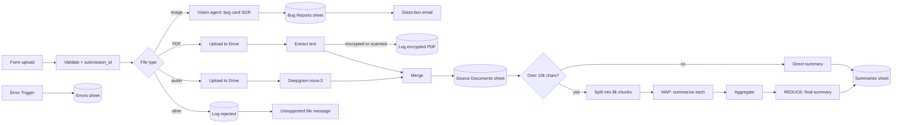

# Structured AI Output System: Multi-Format Data Pipeline

**One form in, structured records out · Vision bug triage (SGR) · PDF + audio intake · Map-Reduce summarization · JSON Schema everywhere**

Teams collect information in whatever format is convenient: a bug screenshot, a spec PDF, an audio recording of a meeting. This n8n pipeline takes all of them through **one form** and turns them into structured, queryable rows in Google Sheets, with the original files stored in Google Drive.

📖 **Full case study:** [Notion portfolio](https://ilona-bila-portfolio.notion.site/3929e4dcbceb80d5bf9df0f26bda61fc)

---

## Problem

Turning a mixed stream of screenshots, PDFs and audio into usable data usually means manual triage. This pipeline removes that human middle step.

---

## How it works

Every submission gets a unique `submission_id` (`YYYYMMDD-XXXXXXXX`), which tags every downstream row and Drive file.

---

## Key design decision

**SGR (Schema-Guided Reasoning) instead of a plain "return JSON" prompt.** For bug triage, a correct format doesn't guarantee a correct decision. `full_reasoning` is the **first** field of the JSON, so the model reasons before it gives a verdict, and the severity call can be traced. A `confidence` score below 0.6 sets `needs_human_review = true`, so the model can say "not sure" instead of guessing.

**A two-tier model strategy for long documents.** A lighter model summarizes each chunk (MAP, the node's default OpenRouter model), and a stronger model writes the final synthesis (REDUCE, `gpt-4.1`). Quality is spent where it matters.

**Upload to Drive first, while the binary is still alive.** Later nodes in n8n drop the binary data, so the original file is stored before processing and then restored for extraction.

---

## Components

| Group | What it does |
|---|---|
| **Intake** | Form Trigger → validation + `submission_id` → Switch by MIME type (image / PDF / audio / default) |
| **Branch 1: vision bug reports** | AI Agent (`gpt-4.1`, vision) with an SGR prompt → auto-fixing + structured output parsers → **Bug Reports** sheet → Gmail "glass-box" email showing the reasoning |
| **Branch 2: documents** | PDF → Drive upload → restore binary → Extract from File. Audio → Drive upload → restore binary → Deepgram nova-3 transcription. Both are normalized, merged and written to **Source Documents** with a Drive link. |
| **Summarization** | Under 10,000 characters → direct summary (`gpt-4.1`). Longer → split into 8k chunks → MAP → aggregate → REDUCE. Both write to **Summaries** through a JSON Schema + auto-fixing parser. |
| **Error handling** | Global Error Trigger → **Errors** sheet. Rejected file types and encrypted PDFs are logged. |

---

## Inputs and outputs

| | |
|---|---|
| **Input** | One n8n form: screenshot (image), PDF, or audio file, plus optional context |
| **Outputs** | Google Sheets: **Bug Reports**, **Source Documents**, **Summaries**, **Errors** · original files in Google Drive · bug-report email |

---

## Error handling and guardrails

| Mechanism | Behavior |
|---|---|
| **Graceful degradation** | Encrypted or scanned PDFs are flagged (`manual_required`), not fatal |
| **Unsupported files** | Logged and answered with a message, never silently dropped |
| **Global Error Trigger** | Any unexpected failure is written to the Errors sheet |
| **Retry on fail** | Drive uploads and Sheets writes retry (2 tries) on temporary errors |
| **Auto-fixing output parsers** | Malformed JSON is repaired by a second model call instead of failing the run |
| **Human-review flag** | Low-confidence bug cards are marked `needs_human_review` |

### Known gaps

- The direct summarizer and the REDUCE agent are set to **continue on error output**, but their error outputs are **not connected**. The fallback chain described in the workflow notes is missing, so a failed summary is not recorded anywhere.

---

## Setup

1. Import `workflow.json` into n8n.
2. Replace placeholders:
   - `YOUR_GOOGLE_SHEET_ID_4`: a spreadsheet with the sheets listed above
   - `YOUR_GOOGLE_DRIVE_FOLDER_ID`: the folder for original files
3. Create credentials: OpenRouter, Google Sheets, Google Drive, Gmail, and an HTTP Header Auth credential for the **Deepgram** API key.

Node names are mixed English/Russian. Prompts are in Russian.
