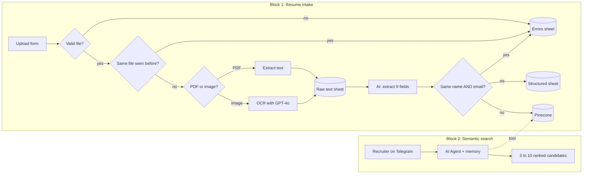

# AI Recruitment Assistant: Resume Intake & Semantic Search

**Resume upload → OCR + AI structuring → Google Sheets + Pinecone · Recruiter asks in plain language on Telegram → ranked candidates**

Two n8n workflows that work as one system. **Block 1** turns uploaded resumes (PDF or image) into structured candidate records and vector embeddings. **Block 2** lets a recruiter search those candidates **by meaning**, not by keywords, through a Telegram chat.

📖 **Full case study:** [Notion portfolio](https://ilona-bila-portfolio.notion.site/3819e4dcbceb81ee9c13cefecf18da75)

---

## Problem

Manual resume screening takes hours per hire, and it still relies on keyword matching that misses the best-fit candidates.

---

## How it works

---

## Key design decision

**Pinecone is a tool the search agent calls, not a fixed retrieve-then-answer step.** The agent decides when and how to query, which holds up better on ambiguous or multi-part recruiter questions than a rigid RAG flow.

**Each resume is stored as a single chunk.** Resumes are 1–2 pages long. Splitting them would separate skills from experience and names from role history. Vector search would then return fragments, and the AI would judge pieces instead of whole candidate profiles.

**Deduplication happens in two layers.** Layer 1 checks the **filename** before any AI call, so duplicates never spend tokens. Layer 2 checks **name AND email** after analysis, to catch the same person submitted with a different file version.

---

## Components

### Block 1: Resume intake (`1-resume-intake-pipeline.json`)

| Step | Details |
|---|---|
| Upload form | Accepts PDF or image resumes |
| File validation + duplicate check (filename) | Invalid or repeated files go to the dead-letter queue |
| File type detection | PDF → text extraction. Image → OCR via GPT-4o (with retry). |
| Raw text | Saved to a raw-text sheet |
| AI analysis | `gpt-4.1-mini` extracts **9 structured fields** through a structured output parser with auto-fix |
| Duplicate check (name + email) | Both must match to count as a duplicate |
| Storage | Structured row in Google Sheets **and** a vector in Pinecone (`text-embedding-3-small`), in parallel |

### Block 2: Semantic candidate search (`2-semantic-candidate-search.json`)

| Step | Details |
|---|---|
| Telegram trigger | The recruiter asks in natural language, e.g. "Python developer with fintech experience" |
| AI Agent | `gpt-4.1-mini` via OpenRouter, with per-chat memory |
| Pinecone tool | Semantic search over the same index, using the same embedding model as Block 1 |
| Reply | 3–10 most relevant candidates with name, position, skills and contact |

---

## Inputs and outputs

| | |
|---|---|
| **Inputs** | Resume files via form (Block 1) · recruiter questions via Telegram (Block 2) |
| **Outputs** | Raw-text sheet, structured candidate sheet, Pinecone vectors, errors sheet · Telegram reply with ranked candidates |

---

## Error handling and guardrails

| Mechanism | Behavior |
|---|---|
| **Dead-letter queue** | Unsupported formats, empty text and duplicates are logged with a reason code. The pipeline never crashes silently. |
| **Two-layer deduplication** | Filename before AI, name + email after AI |
| **Self-healing JSON** | An auto-fixing output parser repairs malformed AI output before it is written |
| **OCR retry** | The image OCR step retries on failure |
| **No invention** | The OCR prompt forbids adding information that isn't in the image |

---

## Setup

1. Import both files into n8n.
2. Replace `YOUR_GOOGLE_SHEET_ID_5`, `_6` and `_7` with your spreadsheets (raw text, structured data, errors).
3. Create a Pinecone index (1536 dimensions for `text-embedding-3-small`) and select it in both workflows.
4. Create credentials: OpenRouter, OpenAI (embeddings), Pinecone, Google Sheets, Telegram.

Node names and prompts are in English.
