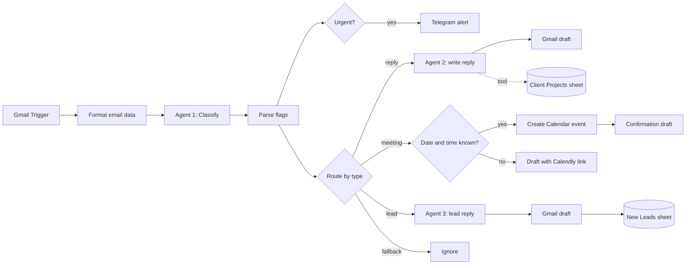

# AI Email Assistant for a Freelance Developer

**Gmail → AI classification → reply / meeting / lead / ignore · Drafts only, the human sends · Telegram alerts for urgent mail**

An n8n workflow that processes a freelancer's incoming Gmail. One AI agent classifies each email. Depending on the result, the workflow drafts a context-aware reply, books a meeting in Google Calendar, answers and logs a new lead, or ignores the email. Urgent emails also trigger a Telegram alert. **Nothing is sent automatically:** every reply lands in Gmail as a draft for the freelancer to review.

📖 **Full case study:** [Notion portfolio](https://ilona-bila-portfolio.notion.site/36e9e4dcbceb81bcbd68e29333e1498a)

---

## Problem

A freelancer receiving **20–40 emails a day** spent **1–2 hours** on manual processing. The assistant reduces this to **10–15 minutes**, saving about 105 minutes every day.

---

## How it works

---

## Key design decision

**OpenRouter as the AI gateway.** Any model (Claude, GPT, Mistral, …) can be swapped in without changing the workflow.

**Claude Haiku for the reply writer.** The default model kept answering in Russian. Agent 2 was switched to Claude Haiku because it follows the language-detection rule (reply in the language of the email: EN / RU / DE) precisely.

**Drafts, not sends.** The assistant prepares everything, but a person always presses Send.

---

## Components

| Agent / step | What it does |
|---|---|
| **Agent 1: Classifier** | Returns flags `needs_reply`, `is_meeting`, `is_new_lead`, `urgency` plus meeting details (title, date, time, duration). |
| **Route by type** | Switch with 4 branches: meeting, lead, reply, fallback |
| **Agent 2: Reply writer** | Claude Haiku (via OpenRouter). Reads the client's current projects from a Google Sheets tool (client, email, project, status, deadline, budget, notes). Detects the language and adjusts the tone to the urgency. |
| **Meeting branch** | Date and time in the email → Google Calendar event + confirmation draft. Otherwise → a draft with a Calendly link, so the client picks a time. |
| **Agent 3: Lead reply** | Personalized answer to a new potential client → Gmail draft → row in the **New Leads** sheet |
| **Urgency alert** | Runs in parallel with routing: urgent emails send a Telegram message |

---

## Inputs and outputs

| | |
|---|---|
| **Input** | New emails in the connected Gmail inbox |
| **Outputs** | Gmail drafts (replies, meeting confirmations, Calendly invites, lead replies) · Google Calendar events · New Leads sheet · Telegram alerts |

---

## Error handling and guardrails

| Mechanism | Behavior |
|---|---|
| **Human sends everything** | All outgoing messages are drafts |
| **Continue on error** | The classifier, flag parser, reply writer and calendar step continue instead of stopping the run |
| **Fallback branch** | Unclassified emails are ignored rather than answered wrongly |
| **Language rule** | Replies are written in the email's own language |

### Known gaps

- **No availability check before creating a Calendar event.** If the time is already taken, the draft must be deleted and answered by hand. This is noted in the workflow as a V2 improvement.
- The Calendly link is a placeholder (`https://calendly.com/your-link`) and must be replaced before activating.

---

## Setup

1. Import `workflow.json` into n8n.
2. Replace placeholders:
   - `YOUR_GOOGLE_SHEET_ID_8`: a spreadsheet with **Projects** and **New Leads** sheets
   - `YOUR_TELEGRAM_CHAT_ID`: where urgent alerts go
   - `you@example.com`: your calendar
   - `https://calendly.com/your-link`: your Calendly URL
3. Create credentials: Gmail, Google Calendar, Google Sheets, OpenRouter, Telegram.

Node names are in English. Prompts and notes are mostly in Russian.
