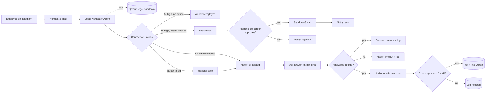

# Legal Navigator: Guardrails Agent with Lawyer Escalation & Self-Updating Knowledge Base

**Telegram · RAG on Qdrant · Confidence-based routing · Human approval before actions · Lawyer escalation with timeout · Approved answers go back into the knowledge base**

An internal Telegram assistant that answers employees' legal and compliance questions for a company ("Globex Solutions GmbH", a training scenario). It answers **only** from the company's legal handbook. It routes each question by how confident it is and whether an action is needed, and it brings in a human whenever it shouldn't decide alone. Lawyers' answers can be approved and added to the knowledge base, so the system learns over time.

---

## Problem

Employees ask legal questions such as approval thresholds, contracts and data handling. A wrong confident answer is costly, and every question sent to a lawyer is slow and expensive. The assistant has to answer what it safely can, ask for approval before acting, escalate what it can't answer, and never let a question get lost.

---

## How it works

A second entry point loads the handbook itself: **upload PDF → extract text → clean and tag → denormalize tables (LLM) → split by document parts → detect topic → chunk → embed → store in Qdrant** with metadata.

---

## Key design decisions

**Route by confidence and action, not just by topic.** The agent returns structured JSON (`confidence: high/low`, `requires_action: true/false`, `answer`, `question`), and a Switch sends it down one of four branches:

| Branch | When | What happens |
|---|---|---|
| **A: just a question** | high confidence, no action | The agent answers the employee directly |
| **B: action required** | high confidence, action needed | An email draft goes to a responsible person for approval (Telegram Send & Wait). Only after approval is it sent via Gmail. |
| **C: escalate to lawyer** | low confidence | The employee is told it was escalated. The lawyer gets the question with a **45-minute** limit. |
| **Fallback** | the output parser failed | Treated exactly like branch C, so the question still reaches a human |

**A human-approved, self-updating knowledge base.** A lawyer's answer is normalized by an LLM with strict anti-hallucination rules (no conditions that the lawyer didn't state). An expert then approves or declines it. Approved answers are inserted into Qdrant with metadata (`source`, `operator_id`, `original_question`, `created_at`, `is_current`, `confidence_type`, `valid_until`), so the same question can be answered automatically next time.

**Strictly grounded answers.** The agent is instructed to answer only from fragments found by `search_legal_guide`.

---

## Components

| Group | Nodes |
|---|---|
| **Input** | Telegram Trigger → Normalize Input |
| **Agent** | LangChain AI Agent (OpenRouter) + Qdrant vector store tool (OpenAI embeddings, collection `legal`) + structured output parser |
| **Branch B** | Draft approval email → Send & Wait approval → Gmail → notify employee (sent / rejected) |
| **Branch C + fallback** | Notify employee → Ask lawyer (Send & Wait) → forward answer or timeout notice → log to Google Sheets |
| **KB update** | Combine Q+A → Basic LLM Chain (`gpt-4o`) → expert approval → Qdrant insert or rejection log |
| **Handbook ingestion** | Form upload → PDF extraction → cleanup code → table denormalization (`gpt-4o`) → split by parts → topic detection → text splitter → Qdrant |

---

## Inputs and outputs

| | |
|---|---|
| **Inputs** | Employee questions via Telegram · handbook PDF via upload form |
| **Outputs** | Telegram answers and status notifications · approved emails sent via Gmail · Google Sheets log (questions, lawyer answers, `kb_status`) · new chunks in Qdrant |

---

## Error handling and guardrails

| Mechanism | Behavior |
|---|---|
| **Confidence gate** | Low-confidence answers never go to the employee as fact. They go to a lawyer. |
| **Approval before action** | No email is sent without a human's approval |
| **Parser fallback** | A malformed agent response is escalated, not dropped |
| **Escalation timeout** | If the lawyer doesn't answer within 45 minutes, the employee is told and the case is logged |
| **KB approval** | Nothing enters the knowledge base without an expert's approval |
| **Anti-hallucination normalization** | The LLM may not add conditions that aren't in the lawyer's answer |

---

## Setup

1. Import `workflow.json` into n8n.
2. Replace placeholders:
   - `YOUR_GOOGLE_SHEET_ID_9`: the log spreadsheet
   - `YOUR_TELEGRAM_CHAT_ID`: the responsible person / lawyer / expert chat
   - `you@example.com`: the email address used in branch B
3. Create credentials: Telegram, OpenRouter, OpenAI (embeddings), Qdrant, Gmail, Google Sheets.
4. Upload your legal handbook through the `Загрузка документа` form to fill the `legal` collection.

Node names are mixed English/Russian. Prompts are in Russian.
